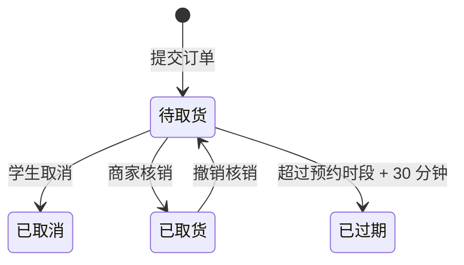

# 校园预订自提 · 多商家微信小程序 Demo

学生提前订、分时取；商家按单备货、到店核销。

一款用于课程展示与产品路演的原生微信小程序。无需后端、无需云开发、无需 npm，全部数据来自本地 Mock 与 `wx` Storage，断网也能完整走通演示流程。

> 门店、商品、价格、订单均为虚构演示数据。

## 项目速览

| 项目 | 说明 |
|---|---|
| 技术栈 | 原生微信小程序 · WXML / WXSS / JavaScript（ES5 风格） |
| 页面数量 | 7 个页面，4 个 tab（首页 / 商品 / 订单 / 商家） |
| 商家数据 | 3 家校园商家 |
| 商品数据 | 4 个品类、24 款商品 |
| 取货时段 | 6 个固定时段 |
| 初始订单 | 9 条商家侧种子订单，其中 3 条属于演示学生 |
| 数据来源 | 纯本地 Mock + `wx.setStorageSync('orders')` |
| 外部依赖 | 无 npm、无 UI 库、无云开发、无网络请求、无支付 |

## 核心功能

### 学生端

- 首页展示 3 家校园商家、4 个品类和跨店推荐。
- 商品页支持「商家 + 品类」双筛选，并按商家交错展示商品。
- 商品详情只选择规格，避免和下单页重复选择。
- 下单页统一选择取货时段、填写取货人与备注。
- 支付流程在本地模拟：提交订单即视为演示支付完成。
- 成功页展示 4 位取货码、取货时段和门店地址。
- 「我的订单」按状态分组，随时查看取货码、取消待取货订单。

### 订单状态

- **待取货**：提交订单后的初始状态。
- **已取货**：商家核销后进入；支持撤销核销。
- **已取消**：学生主动取消，取货码立即失效。
- **已过期**：超过预约取货时间 30 分钟自动过期。

状态流转：



### 商家端

- 可在 3 家门店之间切换，订单与统计数据按门店隔离。
- 今日概览：今日订单数、待取货数、已核销数。
- 分时段备货视图：6 个时段的待取货单量条形图。
- 待取货订单按取货时段分组，显示取货码、商品、数量、规格、取货人、备注。
- 店内核销后实时刷新概览、时段单量和订单分组。
- 已核销订单支持撤销核销。
- 已取消 / 已过期订单默认折叠，避免干扰当前备货。

### 列表体验

首页、商品、我的订单、商家端均包含：

- 首次加载骨架屏；
- 对应空态；
- 下拉刷新。

## 快速开始

无需安装依赖，直接用微信开发者工具打开。

1. 打开微信开发者工具，选择「导入项目」。
2. 项目目录选择本仓库根目录（即包含 `app.json` 的目录）。
3. AppID 可使用自己的小程序 AppID，或选择测试号；基础库建议 **3.17.6 及以上**。
4. 点击「编译」，模拟器默认进入首页。

项目没有网络请求，不需要配置服务器域名，也不需要勾选「不校验合法域名」。

### 重置演示数据

如果之前演示过，想恢复初始订单和统计：

1. 开发者工具工具栏：「清缓存」→「清除数据缓存」；
2. 重新点击「编译」。

应用会在启动时自动补齐种子订单；`demoOrderVersion` 变化时也会重置演示数据。

## 页面一览

| 页面 | 路径 | 作用 |
|---|---|---|
| 首页 | `pages/home/home` | 商家入口、品类入口、推荐商品、我的订单入口 |
| 商品 | `pages/goods/goods` | 商家 / 品类筛选、商品列表 |
| 我的订单 | `pages/orders/orders` | 按状态分组查看订单、取货码、取消预订 |
| 商品详情 | `pages/detail/detail` | 商品信息、规格选择 |
| 确认订单 | `pages/order/order` | 取货时段、取货人、备注、合计 |
| 下单成功 | `pages/success/success` | 4 位取货码、取货信息 |
| 商家端 | `pages/merchant/merchant` | 切店、概览、时段单量、分单、核销与撤销 |

## 演示数据

清除缓存后，商家端初始状态如下（仅统计当前门店）：

| 门店 | 总订单 | 待取货 | 已取消 | 已过期 |
|---|---:|---:|---:|---:|
| 麦香里烘焙 | 4 | 4 | 0 | 0 |
| 青禾轻食 | 3 | 2 | 1 | 0 |
| 甜屿蛋糕 | 2 | 1 | 0 | 1 |

演示学生 `student_demo` 初始有 3 条订单：待取货、已取消、已过期各 1 条，因此首页「我的订单」入口会显示 1 笔待取货。

下单并完成商家核销后，这单会出现在学生「我的订单」的「已取货」分组中。

## 建议演示动线

```text
首页
  → 选一家门店 / 按分类逛
  → 商品详情选规格
  → 下单页选时段、填取货人
  → 提交订单
  → 成功页看 4 位取货码
  → 我的订单再次查看取货码或取消
  → 商家端切到对应门店
  → 核销 / 撤销核销
```

## 工程结构

```text
campus-preorder-demo/
├── app.js                    # 应用启动、演示数据初始化、全局状态
├── app.json                  # 页面注册、窗口、四栏 tabBar
├── app.wxss                  # 设计令牌、主题色块、通用骨架样式
├── project.config.json       # 微信开发者工具项目配置
├── README.md
├── .gitignore
├── utils/
│   ├── format.js             # 价格、日期、时段、比例格式化
│   ├── store.js              # 门店 / 品类 / 商品查询与装饰
│   ├── order.js              # 订单状态机、Storage 操作、过期 / 核销 / 撤销
│   └── mock.js               # 商家、品类、商品、时段、种子订单
└── pages/
    ├── home/                 # 首页
    ├── goods/                # 商品列表
    ├── orders/               # 我的订单
    ├── detail/               # 商品详情
    ├── order/                # 确认下单
    ├── success/              # 下单成功
    └── merchant/             # 商家工作台
```

## 实现说明

### 为什么没有后端

这是一个面向课堂与路演的单机 Demo，重点验证「多商家预订 → 分时取货 → 商家核销」的完整业务闭环，因此：

- 商品与门店数据来自 `utils/mock.js`；
- 订单存入 `wx.setStorageSync('orders')`；
- 图片占位使用 `tone-*` 渐变 + emoji，不依赖外部图片；
- 支付与核销均为本地模拟，可断网运行。

### 数据工具分层

- `utils/format.js`：只负责格式化，不依赖页面。
- `utils/store.js`：只负责门店、品类、商品的数据读取与展示字段装饰。
- `utils/order.js`：统一状态常量、状态流转、Storage 读写和状态分组。
- 页面不重复写 `formatPrice`、`findStoreById`、`getMinPrice` 等逻辑。

### 本地 Storage

- `orders`：订单数组。每条订单包含归属学生 `customerId`、门店、商品、规格、取货码、取货时段、预约时间、状态、备注等字段。
- `demoOrderVersion`：演示数据版本。版本变化时会重建种子数据。

## 当前边界

第一轮只完成主干与状态闭环，以下能力有意留到后续迭代：

- [ ] 购物车、同店多件、数量加减
- [ ] 取货时段容量与余量置灰
- [ ] 商品搜索与排序
- [ ] 商家端商品上下架
- [ ] 真实后端、真实支付、消息通知
- [ ] 配送、评价、分销、直播、拼团

## 适用场景

- 微信小程序课程作业 / 创新创业课程展示
- 校园本地生活服务产品原型
- 多商家预订自提类服务的前端原型验证
- 原生小程序 WXML / WXSS / JS 演示

---

如果这个项目对你有帮助，欢迎 Star。门店、商品、品牌均为虚构数据，仅用于学习与演示；若要正式上线，请替换为自己的品牌、商品与 AppID，并补充服务端、支付、隐私与合规能力。
